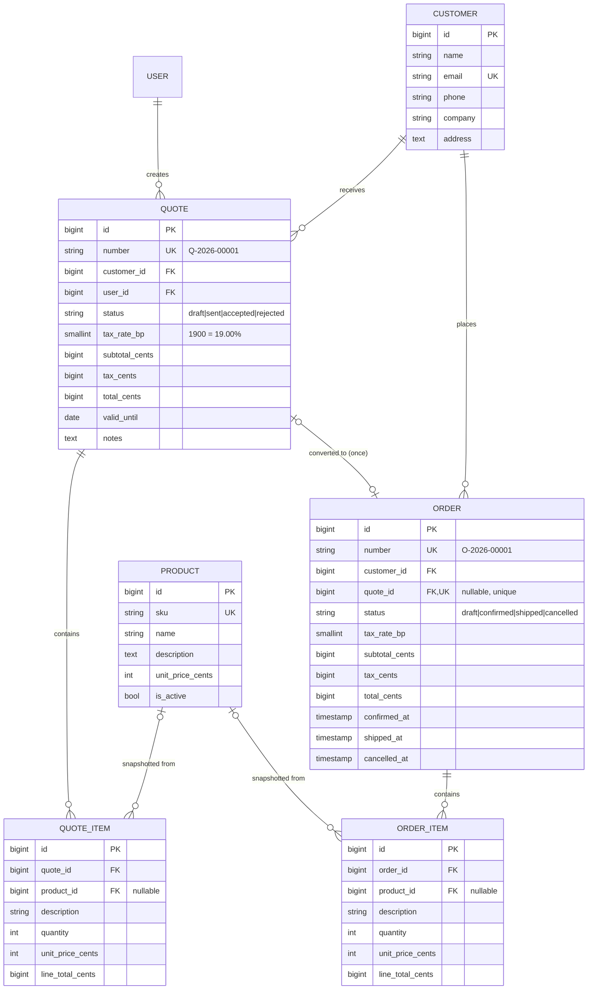

# OrderDesk

[](https://github.com/sl-ee-p/orderdesk/actions/workflows/tests.yml)

A small **quote and order management** app built with Laravel, as a portfolio project. Staff manage customers and products, build quotes with line items, send them, and when a customer accepts, **convert the quote into an order** and move it through shipping. Everything is available both as a web UI and as a JSON REST API.

All data is **fake demo data**. No real customer or company data is used anywhere.

## Features

- **Web UI** (Blade + Tailwind) with login: customers, products, quotes with line items, quote → order conversion, order status workflow.
- **REST API** (`/api/v1`) for the same resources: Sanctum bearer tokens, API Resources, Form Request validation, pagination, filtering and rate limiting.
- **Workflows enforced in one place** (status enums + services), so web and API behave identically:
  - Quote: `draft → sent → accepted | rejected`. Only draft quotes can be edited or deleted; only accepted quotes convert, and only once. A quote past its valid-until date can still be rejected, but no longer sent or accepted.
  - Order: `draft → confirmed → shipped`; draft or confirmed orders can be `cancelled`.
- **Money-safe:** integer cents, tax in basis points, line prices snapshotted at quote time.
- **Tested:** PHPUnit unit and feature tests, run on every push by GitHub Actions (SQLite and MySQL).

The reasoning behind each design choice is written up in plain language in [`docs/DECISIONS.md`](docs/DECISIONS.md).

## Run it (one command)

Requires Docker with Compose.

```bash
docker compose up --build
```

Then open <http://localhost:8000> and log in with **`demo@orderdesk.test` / `password`**.

The first start builds the image, waits for MySQL, runs the migrations and seeds demo data (customers, products, quotes and orders in every status). Restarting does not duplicate the data.

Optional phpMyAdmin on <http://localhost:8080>:

```bash
docker compose --profile tools up --build
```

Stop with `Ctrl+C`; remove the containers and data with `docker compose down -v`. Ports and the demo database password can be overridden with `APP_PORT`, `PMA_PORT`, `DB_PASSWORD` and `DB_ROOT_PASSWORD` in your shell. The credentials in `docker-compose.yml` are for local demos only.

### Without Docker

Requires PHP 8.4+, Composer, Node 22 and a database (SQLite works out of the box).

```bash
composer install
cp .env.example .env && php artisan key:generate
# .env.example targets MySQL; for SQLite set DB_CONNECTION=sqlite and DB_DATABASE=database/database.sqlite (touch the file)
php artisan migrate --seed
npm install && npm run build      # or `npm run dev` while developing
php artisan serve                 # http://localhost:8000
```

## Data model



## API

Base URL `http://localhost:8000/api/v1`. All amounts are integer cents; the tax rate is in basis points (`2200` = 22%). Send `Accept: application/json`.

### Get a token

```bash
curl -s -X POST http://localhost:8000/api/v1/auth/token \
  -H 'Accept: application/json' -H 'Content-Type: application/json' \
  -d '{"email":"demo@orderdesk.test","password":"password","device_name":"curl"}'
# {"token":"1|abc...","token_type":"Bearer"}

export TOKEN='1|abc...'     # paste your token
```

### Read data (paginated)

```bash
curl -s http://localhost:8000/api/v1/customers?per_page=5 \
  -H "Authorization: Bearer $TOKEN" -H 'Accept: application/json'

curl -s 'http://localhost:8000/api/v1/quotes?status=sent' \
  -H "Authorization: Bearer $TOKEN" -H 'Accept: application/json'
```

Lists return `data`, `links` and `meta`; the page `links` keep your filters and page size. `?per_page=` must be a whole number and is clamped to 1–100; quotes and orders accept `?status=` and `?customer_id=` (an unknown status, a non-numeric id or a non-numeric page size is a `422`).

### Create a customer and a product

```bash
curl -s -X POST http://localhost:8000/api/v1/customers \
  -H "Authorization: Bearer $TOKEN" -H 'Accept: application/json' -H 'Content-Type: application/json' \
  -d '{"name":"Jane Doe","email":"jane@example.com","company":"Example Ltd"}'

curl -s -X POST http://localhost:8000/api/v1/products \
  -H "Authorization: Bearer $TOKEN" -H 'Accept: application/json' -H 'Content-Type: application/json' \
  -d '{"sku":"NB-100","name":"Notebook","unit_price_cents":1250,"is_active":true}'
```

`is_active` is optional: new products default to active, and an update that omits it leaves it unchanged.

### Quote → order

```bash
# 1. Create a draft quote (server snapshots product name and price)
curl -s -X POST http://localhost:8000/api/v1/quotes \
  -H "Authorization: Bearer $TOKEN" -H 'Accept: application/json' -H 'Content-Type: application/json' \
  -d '{"customer_id":1,"tax_rate_bp":2200,"items":[{"product_id":1,"quantity":3}]}'

# 2. Send it, then accept it
curl -s -X POST http://localhost:8000/api/v1/quotes/1/status \
  -H "Authorization: Bearer $TOKEN" -H 'Accept: application/json' -H 'Content-Type: application/json' \
  -d '{"status":"sent"}'
curl -s -X POST http://localhost:8000/api/v1/quotes/1/status \
  -H "Authorization: Bearer $TOKEN" -H 'Accept: application/json' -H 'Content-Type: application/json' \
  -d '{"status":"accepted"}'

# 3. Convert the accepted quote into a draft order (201). A second attempt returns 422.
curl -s -X POST http://localhost:8000/api/v1/quotes/1/convert \
  -H "Authorization: Bearer $TOKEN" -H 'Accept: application/json'

# 4. Move the order along
curl -s -X POST http://localhost:8000/api/v1/orders/1/status \
  -H "Authorization: Bearer $TOKEN" -H 'Accept: application/json' -H 'Content-Type: application/json' \
  -d '{"status":"confirmed"}'
```

An illegal step returns `422` with a readable message, e.g. `{"message":"A draft quote cannot become accepted."}`. The same happens when sending or accepting a quote whose optional `valid_until` (a `YYYY-MM-DD` date, valid through that day) has passed.

### Endpoints

| Method | Path | Purpose |
|---|---|---|
| POST / DELETE | `/auth/token` | Create / revoke a token |
| GET, POST | `/customers`, `/products`, `/quotes` | List / create |
| GET, PUT, DELETE | `/customers/{id}`, `/products/{id}`, `/quotes/{id}` | Show / replace / delete (quotes: draft only) |
| GET | `/orders`, `/orders/{id}` | List / show (orders are created only by conversion) |
| POST | `/quotes/{id}/status` | `sent`, `accepted`, `rejected` |
| POST | `/quotes/{id}/convert` | Accepted quote → draft order |
| POST | `/orders/{id}/status` | `confirmed`, `shipped`, `cancelled` |

Status codes: `201` created, `204` deleted, `401` missing/invalid token, `404` not found, `422` validation error or broken business rule, `429` rate limited (token endpoint: 5/min; API: 60/min per user).

## Tests

```bash
composer install
cp .env.example .env && php artisan key:generate
php artisan test                 # uses in-memory SQLite, no setup needed
vendor/bin/pint --test           # code style check (drop --test to fix)
```

To run the suite against MySQL as CI does, export `DB_CONNECTION=mysql DB_HOST=... DB_DATABASE=... DB_USERNAME=... DB_PASSWORD=...` before `php artisan test` (real environment variables override `phpunit.xml`). Use an empty test database; the tests reset it.

## Continuous delivery

Every push and pull request runs the `Tests` workflow: Pint, the suite on SQLite and on MySQL 8.4, and a Docker smoke test. On a push to `main`, once all of those pass, the image is published to GHCR (`ghcr.io/<owner>/orderdesk:<sha>` and `:latest`) and the `deploy` job runs [`deploy/deploy.sh`](deploy/deploy.sh) on a self-hosted runner: it backs up the database, starts the new image with [`deploy/compose.prod.yml`](deploy/compose.prod.yml) (secrets come from the server's `.env`), waits for the app to answer, and rolls back to the previous image if it never becomes healthy.

## Project layout

| Path | What lives there |
|---|---|
| `app/Services` | Business logic: quotes, conversion, order workflow, totals maths |
| `app/Enums` | `QuoteStatus`, `OrderStatus` and their allowed transitions |
| `app/Http/Controllers` | Thin web controllers; `Api/V1` holds the API ones |
| `app/Http/Requests` | Form Request validation (API variants extend the web ones) |
| `app/Http/Resources` | API JSON shapes |
| `app/Exceptions/DomainRuleViolation.php` | Broken business rule → flash message (web) or 422 (API) |
| `database/` | Migrations, factories, `DemoSeeder` |
| `tests/` | Unit tests (pure logic) and feature tests (web + API) |
| `docs/DECISIONS.md` | Why it is built this way |
